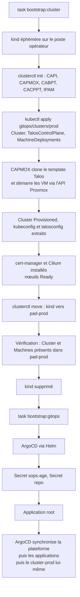

# Bootstrap du cluster

Le cluster `pad-prod` est géré par **Cluster API** (CAPI) **depuis lui-même** : il n'y a pas de cluster de gestion
permanent. Un cluster `kind` éphémère sert uniquement à le créer, puis lui transmet la gestion (pivot) et disparaît.
Cela économise environ 6 Go de RAM en régime établi.

## Étapes détaillées

| Étape | Script | Ce qui se passe | Reprise |
|---|---|---|---|
| 1. kind | `bootstrap/scripts/cluster.sh` | cluster `kind` (version épinglée par digest), `clusterctl init` avec les providers du contrat | saute si le pivot est fait |
| 2. manifests | idem | `kubectl apply --server-side -k gitops/clusters/prod` | rejouable |
| 3. attente | idem | `Cluster` Provisioned, control plane prêt (30 min max) | rejouable |
| 4. accès | idem | extraction du kubeconfig et du talosconfig dans `.state/` | |
| 5. CNI | idem | cert-manager puis Cilium (sans kube-proxy), installés par Helm avec les mêmes versions que les Applications ArgoCD ; attente des nœuds Ready | rejouable |
| 6. pivot | idem | `clusterctl move` vers `pad-prod`, puis contrôle que le `Cluster` et les `Machine` y sont | **kind conservé** si le contrôle échoue |
| 7. ArgoCD | `bootstrap/scripts/gitops.sh` | `helm upgrade --install argo-cd`, Secret `sops-age` (clé du **cluster**), Secret du dépôt, Application `root` | idempotent |

## Après le pivot : ArgoCD gère tout

L'Application `root` synchronise `gitops/platform` ; l'ApplicationSet `apps` crée une Application par dossier de
`gitops/apps/*`. L'ordre d'installation est porté par les `sync-wave` :

| Vague | Composants |
|---|---|
| -10 | namespaces, CRD Prometheus |
| -9 | Cilium |
| -7 / -6 | cert-manager / Kyverno |
| -5 | ArgoCD (auto-géré), Proxmox CSI, CRD mariadb-operator |
| -4 | mariadb-operator, politiques Kyverno, providers CAPI |
| -3 | Traefik, KEDA, cluster-autoscaler, external-dns |
| -2 | Valkey, Garage, Zot |
| -1 | Alloy, kube-state-metrics, node-exporter |
| 5 | `cluster-prod` : les manifestes CAPI eux-mêmes, désormais sous ArgoCD |
| 10 | applications : CTFd, front, chall-manager, netbird-sync |

Les secrets sont à la vague -8 (voir [Chaîne des secrets](secrets.md)).

!!! info "Pas de `kubectl apply` hors `bootstrap/`"
    Après le bootstrap, plus rien n'est appliqué à la main. Pour changer le cluster, on modifie `gitops/` et on
    pousse. Le cluster se met à jour ensuite via ArgoCD, y compris ses propres MachineDeployments.

## Destruction

`task bootstrap:destroy` fait le chemin inverse : pivot inverse vers un `kind` frais, suppression du `Cluster` (CAPI
détruit les VM), avec repli sur l'API Proxmox (confirmation requise) si CAPI ne peut plus agir. Voir
[destroy](../runbooks/destroy.md).
