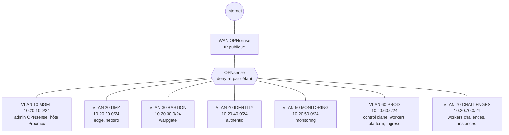
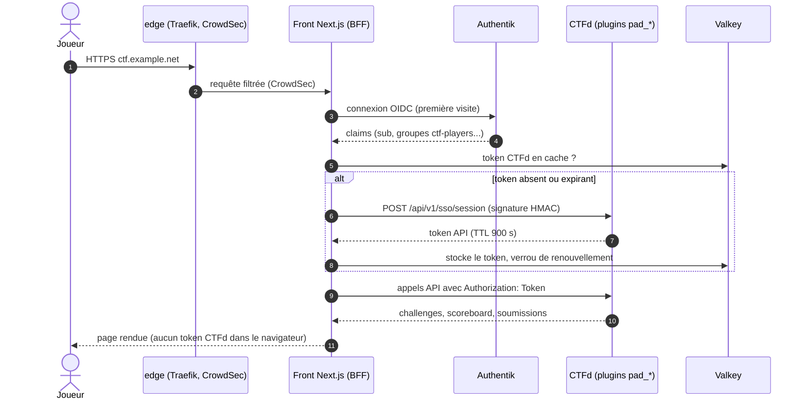

# Architecture

PenetrateAndDestroy tient sur **un seul serveur Proxmox**. Les services d'infrastructure tournent dans des **LXC**
(Docker Compose) ; le routeur (OPNsense) et les nœuds Kubernetes (Talos) sont des **VM**. Tout ce qui est applicatif
tourne dans le cluster Kubernetes `pad-prod`, piloté par ArgoCD.

## Composants

| Couche | Composant | Type | Rôle |
|---|---|---|---|
| Hôte | Proxmox VE, ZFS | bare metal | hyperviseur, stockage, bridge `vmbr2` |
| Réseau | OPNsense | VM | routeur, pare-feu inter-zones, DNS interne (Unbound), IDS |
| Bordure | `edge` (Traefik + CrowdSec) | LXC, zone DMZ | TLS, reverse proxy public, bannissement |
| Accès | `netbird` | LXC, zone DMZ | VPN WireGuard des joueurs et du staff |
| Accès | `warpgate` | LXC, zone BASTION | bastion SSH/HTTPS pour le staff |
| Identité | `authentik` | LXC, zone IDENTITY | IdP OIDC, flows d'inscription |
| Supervision | `monitoring` | LXC, zone MONITORING | VictoriaMetrics, Loki, Tempo, Grafana, Alertmanager, Uptime Kuma |
| Cluster | `pad-prod` (Talos) | VM, zones PROD et CHALLENGES | plateforme et applications |
| Applications | front, CTFd, chall-manager, netbird-sync | pods | le CTF lui-même |

## Zones et VLAN

Un bridge `vmbr2` VLAN-aware, **sans uplink**, relie toutes les zones. Seule la VM OPNsense le traverse : tout trafic
inter-zones passe donc par ses règles.

Détail des plages, des adresses et du WAN : [Réseau et zones](reseau.md). Règles autorisées :
[Matrice de flux](flux.md).

## Parcours d'une requête joueur

Le joueur ne parle qu'au front. Le front ne détient aucun token CTFd côté navigateur : le serveur du front (BFF)
échange l'identité OIDC contre un token API court, puis appelle CTFd.

Le contrat exact de cette API est dans [API des plugins CTFd](../reference/api-plugins.md).

## Exposition publique et privée

| Ce qui est public (Internet, ports 80/443) | Ce qui exige NetBird (VPN) |
|---|---|
| front (`ctf`), Authentik (`auth`), NetBird (`vpn`), page de statut (`status`) | **instances de challenges**, bastion Warpgate, Grafana, ArgoCD, registry, UI d'admin CTFd, Alertmanager, Hubble |

Les noms de domaine viennent des `hostnames` du [contrat](../reference/contrat.md).

## Où lire ensuite

- [Cycle de vie d'une instance](instances.md) : du clic du joueur à la règle NetBird.
- [Bootstrap du cluster](bootstrap.md) : de `kind` à ArgoCD.
- [Chaîne des secrets](secrets.md) : de `sops` au pod.
- [Scaling](scaling.md) et [Supervision](supervision.md).
- [Décisions d'architecture](../adr/index.md) : pourquoi ces choix.
