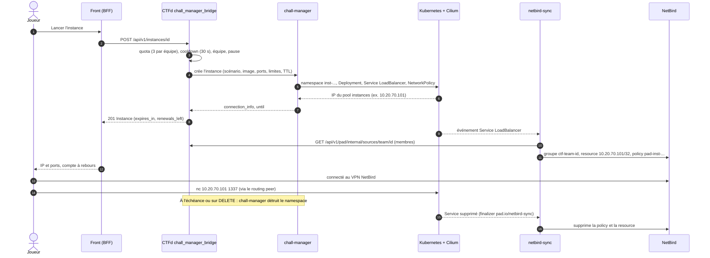

# Cycle de vie d'une instance

Un challenge « instancié » donne à chaque **équipe** (ou à chaque joueur en mode individuel) son propre
environnement, créé à la demande, borné par un TTL et détruit à l'expiration.

## Acteurs

| Acteur | Rôle |
|---|---|
| Front (BFF) | boutons lancer, prolonger, arrêter ; compte à rebours ; rappel NetBird |
| CTFd, plugin `chall_manager_bridge` | API `/api/v1/instances/...` ; quota, cooldown, renouvellements ; identité `team-<id>` ou `user-<id>` |
| chall-manager | exécute le **scénario** (Pulumi, `apps/chall-manager-scenario`) : crée et détruit les ressources Kubernetes |
| Kubernetes + Cilium | namespace `inst-*`, pod, Service `LoadBalancer`, NetworkPolicy ; IP allouée par LB-IPAM |
| netbird-sync | pour chaque Service d'instance, crée la resource et la policy NetBird de l'équipe |
| NetBird + routing peer | route `100.64.0.0/10` (overlay) vers l'IP d'instance, pour l'équipe seulement |

## Séquence

## Garanties

- **Isolement entre instances** : une `NetworkPolicy` par instance (Cilium), pods en PSS `restricted` appliqué par
  Kyverno, `ResourceQuota` et `LimitRange` bornant CPU et mémoire.
- **Aucune exposition Internet** : l'IP d'instance est dans la zone CHALLENGES, qui n'a aucune règle entrante depuis
  Internet. Seul NetBird, via le routing peer, y accède, et seulement pour le groupe de l'équipe.
- **Pas de flag dans l'API** : les flags d'instance (mode `per_instance_flag`) ne sont jamais renvoyés au front.
- **Nettoyage** : le finalizer `pad.io/netbird-sync` garantit que la policy NetBird est retirée *avant* la
  disparition du Service. Une réconciliation complète a lieu toutes les 10 minutes.

## Limites et quotas

| Paramètre | Défaut | Variable CTFd |
|---|---|---|
| instances simultanées par équipe | 3 | `PAD_INSTANCES_MAX_PER_SOURCE` |
| délai entre deux créations | 30 s | `PAD_INSTANCES_COOLDOWN_SECONDS` |
| TTL d'une instance | 1 h (60 s à 6 h, défini par `instance.ttl`) | `challenge.yml` |
| renouvellements | selon le challenge (`max_renewals`) | API admin |

Les managers et admins contournent quota, cooldown, renouvellements et pause : c'est ce que le portail utilise pour le
[test d'instance](../manager/exploitation-evenement.md).

## Dérive et diagnostic

Deux alertes surveillent ce cycle : `CtfdInstancesDrift` (écart entre les instances connues de CTFd et les namespaces
`inst-*`) et `ChallManagerErrorRate`. Les procédures sont dans [Instances](../runbooks/instances.md) et
[netbird-sync](../runbooks/netbird-sync.md).
