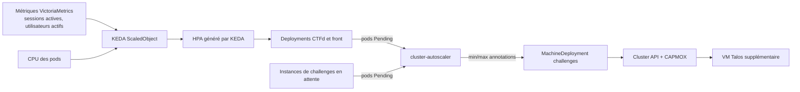

# Scaling

Le scaling se fait à trois niveaux : les pods applicatifs (KEDA), les nœuds (cluster-autoscaler) et les instances de
challenges (quotas et TTL).



## Pods : KEDA

Un **seul** `ScaledObject` KEDA par Deployment, avec deux triggers (KEDA génère l'HPA, il n'y a pas d'HPA séparé).

| Composant | Réplicas | Trigger CPU | Trigger applicatif | Seuil |
|---|---|---|---|---|
| front | 2 à 4 | utilisation 70 % | `max(pad_frontend_active_sessions)` | 150 sessions actives par réplica |
| CTFd | 2 à 4 | utilisation 70 % | `max(ctfd_active_users{window="5m"})` | 100 utilisateurs actifs par réplica |
| chall-manager | 1 à 1 | CPU | | plafonné à 1 tant que le stockage est RWO |

!!! warning "`max()`, jamais `sum()`"
    Les gauges applicatives sont identiques sur chaque pod (calculées depuis la base). Les agréger avec `max()`.
    Un `sum()` multiplierait la charge par le nombre de réplicas et ferait diverger l'autoscaling.

Le seuil du front doit être calibré avec le test de charge (voir plus bas) : c'est un point ouvert des
[limites connues](../reference/limites.md).

## Nœuds : cluster-autoscaler

Le provider `clusterapi` pilote la `MachineDeployment` du pool `challenges` dans les bornes portées par ses annotations
(`cluster.x-k8s.io/cluster-api-autoscaler-node-group-min-size` et `...-max-size`, 1 à 3 par défaut). Il ajoute une VM
Talos quand des pods restent `Pending` faute de ressources, et retire un nœud resté sous 50 % d'utilisation pendant
5 minutes. Les workers `challenges` sont **tainted** (`pad.io/pool=challenges:NoSchedule`) : seules les instances de
challenges s'y planifient.

Le pool `platform` (2 workers) n'est pas autoscalé.

### Adapter à un hôte plus gros

Les bornes viennent du contrat (`kubernetes.pools.challenges.min` et `.max`) et se répercutent dans
`gitops/clusters/prod/pool-challenges.yaml`. Pour un hôte plus généreux : relever `max`, la plage `ip_pool` de la zone
CHALLENGES si besoin, et vérifier le budget :

| Composant | vCPU | RAM |
|---|---|---|
| OPNsense | 2 | 1,5 Go |
| edge / netbird / warpgate | 1 / 1 / 1 | 512 Mo / 1 Go / 512 Mo |
| authentik / monitoring / nbrouter | 2 / 2 / 1 | 1,5 Go / 3 Go / 512 Mo |
| Talos control plane | 2 | 4 Go (kube-apiserver dépasse 1,2 Go une fois les CRD de la plateforme installées : 2,5 Go saturait le nœud) |
| Talos workers `platform` (x2) | 2 chacun | 4,5 Go chacun (à 3,5 Go, les requests de la plateforme dépassaient la capacité : Zot, Garage, Valkey restaient Pending) |
| Talos workers `challenges` (1 à 2) | 2 chacun | 2,5 Go chacun |
| ARC ZFS (plafond) | | 2 Go |
| Réserve de l'hôte (Proxmox, noyau) | | 2 Go |

> 256 Mo ne suffisent pas aux LXC warpgate et nbrouter : agent NetBird + Alloy + `apt-get` y déclenchent l'OOM killer du
> cgroup (`dmesg` : `oom_memcg=/lxc/<vmid>`, tâche Ansible en `rc: -9`). Minimum : 512 Mo.

**Pic** (pool `challenges` à son maximum) : environ 30,5 Go, pour un hôte de 32 Go. `task check:0-prereqs` le calcule
depuis le contrat et **échoue** s'il dépasse la RAM de l'hôte. Les pools sont remplacés sans surge (`maxSurge: 0`) :
un rolling update n'ajoute jamais de VM au budget. Dépasser la RAM n'échoue pas proprement : l'hôte entre en
récupération mémoire (ZFS + invités), se fige (`rcu_preempt detected stalls`) et ne se récupère que par un redémarrage
matériel (cas vécu avec l'ARC à 4 Go, des workers à 5 Go et une surge de rolling update).

## Instances

Chaque instance a une `ResourceQuota` et un `LimitRange`, un TTL (voir [cycle de vie](instances.md)) et un quota par
équipe. La capacité réelle du pool `challenges` borne donc le nombre d'instances simultanées.

## Valider : test de charge k6

`tests/load/pad.js` exécute quatre scénarios en parallèle (navigation, soumissions de flags, flux SSE du scoreboard,
cycle d'instances) avec des seuils qui font échouer le test s'ils sont dépassés.

```bash
task load                       # profil smoke (2 VUs, 20 s)
PAD_PROFILE=load task load      # 50 VUs, 5 min
PAD_PROFILE=stress task load    # 200 VUs, 10 min, en observant KEDA puis le cluster-autoscaler
```

Pendant le profil `stress`, relever `PAD_INSTANCES_MAX_PER_SOURCE` et `PAD_INSTANCES_COOLDOWN_SECONDS` côté CTFd, sinon
la plupart des lancements d'instances seront refusés en 429. Les seuils et variables sont décrits dans
`tests/load/README.md`.

Alertes associées : `KedaScalerErrors`, `HpaMaxedOut`, `ClusterAutoscaler*`. Runbook :
[autoscaling](../runbooks/autoscaling.md).
