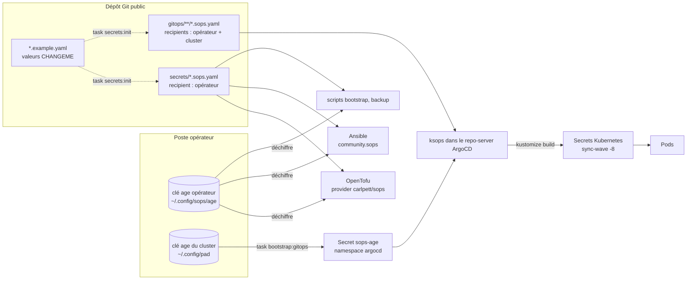

# Chaîne des secrets

Le dépôt est public : les secrets y sont **commités chiffrés** avec SOPS et age. Aucune clé privée n'est dans le
dépôt. La procédure opérateur détaillée est dans [Secrets](../SECRETS.md) ; cette page montre le chemin d'un secret du
fichier chiffré jusqu'au processus qui l'utilise.

## Deux clés, deux périmètres

| Clé | Où elle vit | Ce qu'elle déchiffre |
|---|---|---|
| Opérateur | poste opérateur, sauvegardée hors machine | tout : `secrets/**` et `gitops/**` |
| Cluster | poste opérateur, puis Secret `sops-age` dans ArgoCD | `gitops/**` uniquement |

Conséquence : un attaquant qui compromet le cluster n'obtient ni les jetons Proxmox, ni OVH, ni la configuration
d'Authentik. `bootstrap:gitops` refuse d'injecter la clé opérateur dans le cluster.

## Garde-fous

- **Avant de commiter** : `bash scripts/check-sops.sh` (ou `task secrets:check`). Il exige un bloc `sops:` complet dans
  chaque `*.sops.*`, aucune valeur hors `ENC[...]`, aucun `CHANGEME`, aucune clé privée suivie.
- **En CI** : la validation de `gitops/` travaille sur une copie, avec une clé age éphémère qui chiffre les
  `*.example.yaml`. La CI n'a **jamais** accès à une vraie clé. gitleaks complète le dispositif.
- **Valeurs partagées** : certaines valeurs doivent être identiques à deux endroits (secret HMAC entre front et CTFd,
  jeton interne entre CTFd et netbird-sync, mot de passe Valkey, clé S3 Garage de CTFd...). `task secrets:init` les génère une seule fois et les recopie.
  Les secrets des clients OIDC sont produits par tofu (`30-authentik`) et recopiés par `task secrets:oidc-sync`.

## Rotation

La rotation de la clé du cluster, d'un secret HMAC ou d'un jeton est décrite dans le
[runbook de rotation](../runbooks/rotation-secrets.md).
