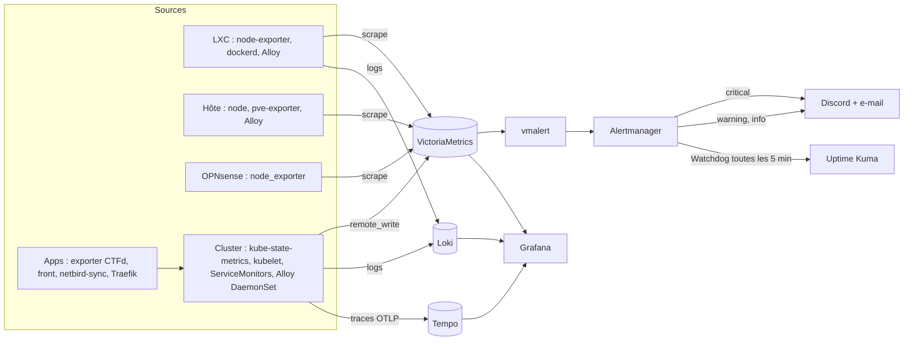

# Supervision

La stack de supervision tourne sur le LXC `monitoring` (zone MONITORING). Elle est déployée par le rôle Ansible
`monitoring-stack` ; son contenu (dashboards, règles, Alertmanager) est versionné dans `monitoring/`.



## Sens des flux

Conforme à la [matrice de flux](flux.md) : toutes les zones **poussent** vers MONITORING (remote_write 8428, Loki
3100, OTLP 4317/4318), et MONITORING **scrape** les exporters (9000-9999, kubelet, Alloy 12345). Aucun autre flux.

## Dashboards

Quatre dashboards versionnés (générés par `monitoring/scripts/build_dashboards.py`, uid stables) :

| uid | Contenu |
|---|---|
| `pad-platform` | ArgoCD, kube-state-metrics, cAdvisor, Traefik, logs |
| `pad-live-ctf` | utilisateurs, soumissions, first bloods, front, netbird-sync, instances |
| `pad-security` | CrowdSec, Authentik, OPNsense, NetBird, Kyverno |
| `pad-capacity` | Proxmox, ZFS ARC, autoscaler, KEDA |

Grafana est interne (NetBird staff, SSO Authentik). Datasources provisionnées : `victoriametrics`, `loki`, `tempo`,
`alertmanager`.

## Alertes

Chaque alerte porte `severity` (`critical`, `warning`, `info`, `none` pour `Watchdog`) et trois annotations :
`summary`, `description`, `runbook_url`. Le `runbook_url` pointe vers une page de la section
[Runbooks](../runbooks/index.md).

| Sévérité | Canal | Rappel |
|---|---|---|
| `critical` | Discord + e-mail | 1 h |
| `warning` | Discord | 4 h |
| `info` | Discord (canal distinct possible) | 24 h |
| `none` (Watchdog) | heartbeat Uptime Kuma uniquement | - |

Inhibitions : une cible down masque ses symptômes, le routeur OPNsense HS masque les alertes de réseau, une variante
critique masque la variante warning de la même alerte, un composant arrêté masque ses alertes dérivées.

## Dead-man's switch

La règle `Watchdog` est toujours active. Alertmanager l'envoie toutes les 5 minutes à un moniteur « push » d'Uptime
Kuma qui alerte si le heartbeat s'arrête : si vmalert, Alertmanager ou le LXC tombe, vous en êtes informé. Voir
[watchdog](../runbooks/watchdog.md). Le LXC héberge aussi Uptime Kuma : une panne totale du LXC n'est détectée que
par un second point de vue (voir [limites connues](../reference/limites.md)).

## Sondes externes

Uptime Kuma décrit ses sondes dans `monitoring/uptime-kuma/monitors.yml` (appliquées par `sync.py`) et publie la page de
statut publique (`status.example.net`).

## Valider les règles

```bash
bash monitoring/scripts/check.sh              # promtool, amtool, vmalert, dashboards, secrets
python3 monitoring/scripts/validate.py runbooks   # runbooks référencés par les alertes
```
