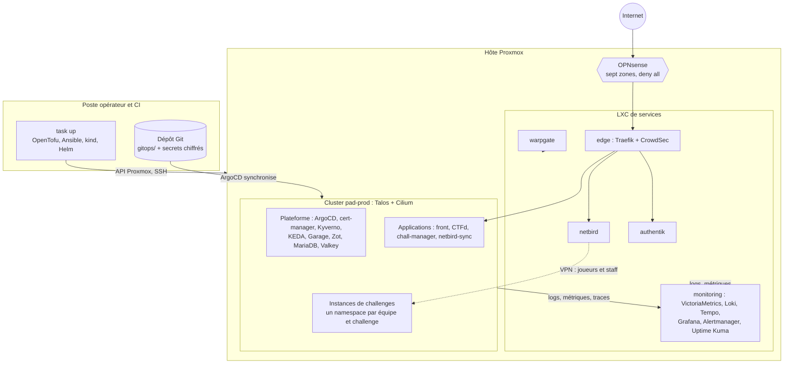
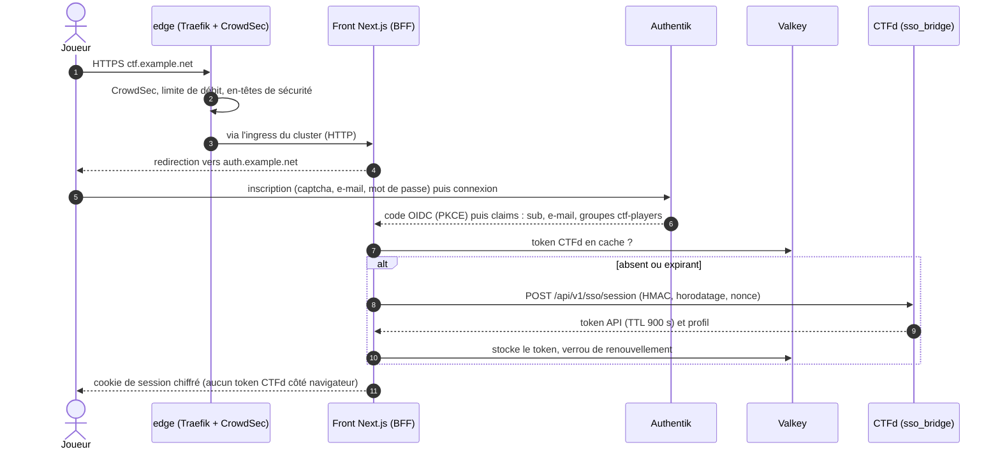
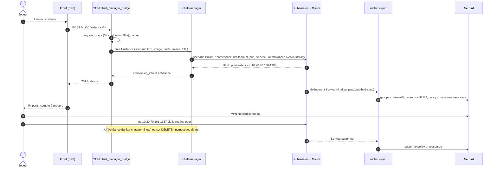
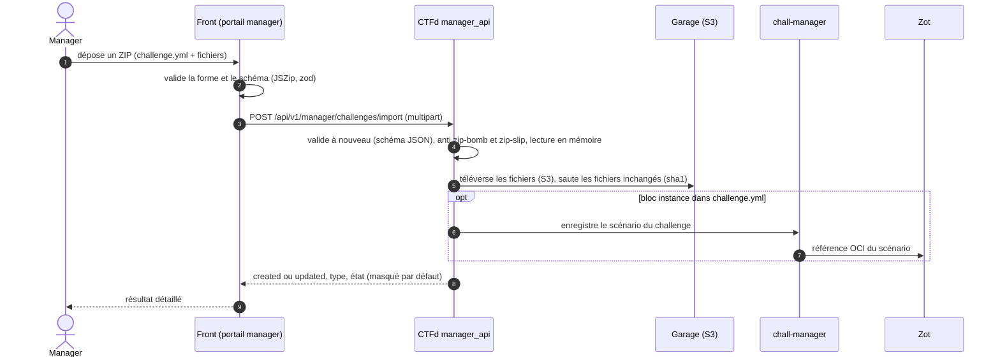
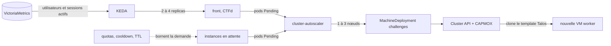
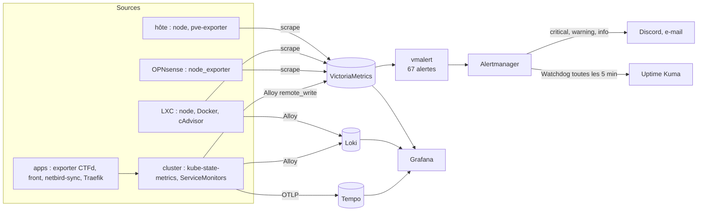
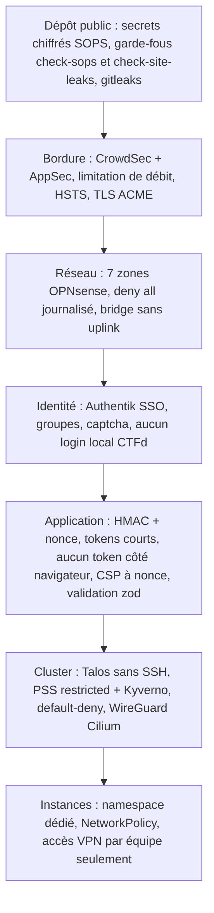

# Comment tout fonctionne

Cette page raconte la plateforme **de bout en bout** : ce que fait `task up`, ce qui se passe quand un joueur ouvre le site puis lance une
instance, quand un manager importe un challenge, comment la plateforme monte en charge, comment elle se surveille et comment elle se protège.
Chaque brique citée renvoie vers sa page de la section [Composants](composants/index.md) ; les décisions de fond sont dans les [ADR](adr/index.md).

!!! note "Valeurs d'exemple"
    Domaine `example.net`, plages privées du [contrat](reference/contrat.md) (`10.20.0.0/16`), secrets `CHANGEME`. Les valeurs propres à
    un hôte réel sont des entrées chiffrées de l'opérateur ([Valeurs de site](reference/site.md)).

## 1. Vue d'ensemble

Un **seul hôte [Proxmox](composants/proxmox-ve.md)** porte tout. Un routeur [OPNsense](composants/opnsense.md) découpe le réseau en sept zones. Les services d'infrastructure (bordure, VPN,
bastion, identité, supervision) tournent dans des **LXC** en Docker Compose, hors du cluster, pour survivre à sa reconstruction. Le cluster Kubernetes `pad-prod`
([Talos](composants/talos.md), [Cluster API](composants/cluster-api.md)) héberge la plateforme et les applications CTF, pilotées par [ArgoCD](composants/argocd.md).

## 2. `task up` : de l'hôte vide à la plateforme

`task up` (Taskfile racine) enchaîne treize étapes idempotentes. Chacune peut être rejouée : on corrige, on relance, et seule la partie manquante bouge.
Prérequis : `nix develop` ([Nix](composants/nix.md)), clés age ([SOPS](composants/sops-age-ksops.md)), `secrets/proxmox.sops.yaml` et `secrets/site.sops.yaml` renseignés.

```mermaid
flowchart LR
    A[00 réseau hôte] --> B[ansible:host]
    B --> C[10 routeur]
    C --> D[15 image Talos]
    D --> E[60 règles OPNsense]
    E --> F[20 LXC]
    F --> G[ansible:services<br/>passe 1]
    G --> H[30 Authentik]
    H --> H2[oidc-sync, ansible:services<br/>passe 2]
    H2 --> I[bootstrap:cluster]
    I --> J[bootstrap:gitops]
    J --> K[40 NetBird, 50 Warpgate, 70 DNS]
    K --> L[verify]
```

| # | Étape | Ce qu'elle crée | Brique qui intervient |
|---|---|---|---|
| 1 | `tofu 00-host-network` | bridge `vmbr2` VLAN-aware **sans uplink**, bridge de transit `vmbr1` (mode NAT), interface `vmbr2.10` (IP de l'hôte en zone MGMT) | [OpenTofu](composants/opentofu.md), [bpg/proxmox](composants/tofu-bpg-proxmox.md) |
| 2 | `ansible:host` | plafond de l'ARC ZFS (4 GiB), sysctl, DNAT de repli, node-exporter, pve-exporter (utilisateur en lecture seule), Alloy | [Ansible](composants/ansible.md), [Proxmox](composants/proxmox-ve.md) |
| 3 | `tofu 10-router` | VM OPNsense : image nano vérifiée par sha256, ISO de configuration importée au premier boot, VLANs, Unbound, SSH par clé | [OPNsense](composants/opnsense.md) |
| 4 | `tofu 15-talos-image` | schematic Image Factory (qemu-guest-agent), image Talos, **VM template** clonée plus tard par Cluster API | [Talos](composants/talos.md) |
| 5 | `tofu 60-opnsense-rules` | la matrice de flux : règles « automation » puis blocage final journalisé | [provider OPNsense](composants/tofu-opnsense.md), [Matrice de flux](architecture/flux.md) |
| 6 | `tofu 20-services-lxc` | six LXC Debian 13 non privilégiés (nesting et keyctl) : edge, netbird, warpgate, authentik, monitoring, nbrouter ; génère l'inventaire Ansible | [bpg/proxmox](composants/tofu-bpg-proxmox.md) |
| 7 | `ansible:services` (passe 1) | **monitoring, authentik, edge** : durcissement, Docker, Alloy, puis le Compose du service | [Docker](composants/docker-lxc.md), [Traefik edge](composants/traefik-edge.md), [CrowdSec](composants/crowdsec.md), [Authentik](composants/authentik.md), [NetBird](composants/netbird.md), [Warpgate](composants/warpgate.md) |
| 8 | `tofu 30-authentik` | groupes du contrat, providers OAuth2 et applications (un client par brique, secrets générés), flows d'inscription (captcha), MFA du staff, anti-brute-force, forward-auth | [provider Authentik](composants/tofu-authentik.md) |
| 8b | `oidc-sync`, `ansible:services` (passe 2) | recopie des secrets OIDC dans les sops, puis **warpgate, netbird** et rejeu de monitoring (Grafana) | [Secrets](SECRETS.md), [NetBird](composants/netbird.md), [Warpgate](composants/warpgate.md) |
| 9 | `bootstrap:cluster` | cluster `kind` éphémère, Cluster API, `pad-prod`, Cilium, **pivot** (`clusterctl move`), suppression de kind | [kind](composants/kind.md), [Cluster API](composants/cluster-api.md), [CAPMOX](composants/capmox.md), [Cilium](composants/cilium-hubble.md) |
| 10 | `bootstrap:gitops` | ArgoCD (Helm), Secret `sops-age` (clé du **cluster**), Secret du dépôt, Application `root` | [ArgoCD](composants/argocd.md), [ksops](composants/sops-age-ksops.md) |
| 11 | `tofu 40-netbird`, `50-warpgate`, `70-dns` | groupes, networks et policies NetBird ; rôles et cibles Warpgate ; enregistrements DNS publics | [NetBird](composants/tofu-netbird.md), [Warpgate](composants/tofu-warpgate.md), [OVH](composants/tofu-ovh.md) |
| 12 | `verify` | smoke tests : endpoints, SSO, ArgoCD, matrice de flux | `scripts/verify.sh` |

Quelques points à retenir :

- **Pourquoi cet ordre.** Le routeur et ses règles précèdent les LXC (il faut une passerelle) ; les LXC précèdent Authentik (l'IdP est un LXC) ; le cluster vient après l'identité, car ArgoCD s'y
  raccorde en OIDC ; NetBird et Warpgate se configurent par API une fois **déployés**, donc après les LXC.
- **Pourquoi deux passes de services.** Les secrets des clients OIDC de NetBird, Warpgate et Grafana sont générés par `30-authentik`, qui a besoin d'Authentik et de l'edge. La passe 1 déploie monitoring, Authentik et l'edge ;
  après `30-authentik`, `oidc-sync` recopie les secrets (chiffrés, jamais affichés) et la passe 2 déploie Warpgate et NetBird. Les certificats ACME de l'edge sont en DNS-01 : ils ne dépendent pas de l'existence des backends.
  `30-authentik` se joue depuis le bastion ou la zone management (la console d'Authentik n'est plus exposée à Internet).
- **Le bootstrap est reprenable.** Si le pivot échoue, kind est **conservé** ; si le pivot a eu lieu, ses étapes sont sautées ([Bootstrap](architecture/bootstrap.md)).
- **Après le bootstrap, plus de `kubectl apply` manuel** : ArgoCD déroule le contenu de `gitops/` par vagues (`sync-wave`).

### Ce que déroule ArgoCD

```mermaid
flowchart LR
    R[Application root] --> W10[-10 namespaces, CRD Prometheus]
    W10 --> W9[-9 Cilium]
    W9 --> W7[-7 cert-manager<br/>-6 Kyverno]
    W7 --> W5[-5 ArgoCD, Proxmox CSI<br/>-4 operator MariaDB, politiques, providers CAPI]
    W5 --> W3[-3 Traefik, KEDA, autoscaler, external-dns]
    W3 --> W2[-2 Valkey, Garage, Zot]
    W2 --> W1[-1 Alloy, métriques]
    W1 --> W5b[5 cluster-prod<br/>le cluster se décrit lui-même]
    W5b --> W10b[10 ApplicationSet : CTFd, front,<br/>chall-manager, netbird-sync]
```

Les secrets Kubernetes sont à la vague -8 : chiffrés dans le dépôt, déchiffrés par [ksops](composants/sops-age-ksops.md) dans le repo-server d'ArgoCD avec la clé age **du cluster**
(qui ne peut jamais lire les secrets d'infrastructure). Détail : [Chaîne des secrets](architecture/secrets.md).

La destruction est symétrique : `task destroy` (confirmation explicite) supprime le cluster (pivot inverse), puis les stacks dans l'ordre inverse ; l'hôte seul reste. `task rebuild` chronomètre les deux.

## 3. Le parcours d'un joueur

### 3.1 Inscription et connexion

1. **La bordure.** Le trafic public arrive sur [OPNsense](composants/opnsense.md), qui le redirige (ports 80 et 443) vers [Traefik edge](composants/traefik-edge.md). Avant tout routage, le plugin bouncer interroge
   [CrowdSec](composants/crowdsec.md) (bannissements, WAF), puis la limitation de débit et les en-têtes de sécurité s'appliquent. Traefik termine le TLS (certificat ACME par DNS-01 chez OVH) et transmet en HTTP à l'ingress du cluster
   ([Traefik cluster](composants/traefik-cluster.md), `10.20.60.200`).
2. **L'inscription.** Elle se passe dans [Authentik](composants/authentik.md) : flow d'inscription avec captcha, vérification d'e-mail et politique de mot de passe, le compte est créé inactif, activé après vérification de l'e-mail, et placé dans le groupe `ctf-players`.
   CTFd n'a **aucun** formulaire de login (404).
3. **Le front.** [Auth.js](composants/frontend.md) conduit le flux OIDC (PKCE, `state`, `nonce`) et garde les claims dans un cookie de session chiffré (12 h).
4. **Le pont vers CTFd.** Le BFF signe une requête HMAC vers [sso_bridge](composants/ctfd-plugin-sso-bridge.md) : CTFd crée ou met à jour l'utilisateur, synchronise ses rôles depuis les groupes, et renvoie un token d'API de 900 s.
   Le token est partagé entre replicas via [Valkey](composants/valkey.md) (un verrou évite N appels simultanés). Le navigateur ne le voit jamais.

### 3.2 Équipe, challenges, flags

Les écrans d'équipe passent par [pad_teams](composants/ctfd-plugin-pad-teams.md) (mots de passe d'équipe protégés contre la force brute). Les challenges, le scoreboard, les indices et les soumissions utilisent l'API native de CTFd,
appelée **par le BFF** avec le token du joueur ; [pad_public](composants/ctfd-plugin-pad-public.md) ajoute l'état de l'événement et les first bloods. Une soumission est un `POST /api/v1/challenges/attempt` ; le
scoreboard en direct est poussé au navigateur par un flux SSE servi par le front. Les fichiers de challenge sont relayés par le BFF (l'URL signée de CTFd n'atteint jamais le navigateur).

### 3.3 Lancer une instance et y accéder

- **Côté CTFd** ([chall_manager_bridge](composants/ctfd-plugin-chall-manager-bridge.md)) : l'identité transmise est `team-<id>` (ou `user-<id>` en mode individuel). Le plugin vérifie l'équipe, le quota, le cooldown, la pause, puis appelle
  [chall-manager](composants/chall-manager.md). Le flag d'instance n'est jamais renvoyé au front.
- **Côté chall-manager** : il télécharge le [scénario Pulumi](composants/chall-manager-scenario.md) depuis [Zot](composants/zot.md) et l'exécute avec un ServiceAccount aux droits limités. Le scénario crée un namespace `inst-*` en PSS
  `restricted`, un pod placé sur le pool **challenges** (taint, `hostUsers: false`), un Service `LoadBalancer` dont l'IP vient du pool `instances` de [Cilium](composants/cilium-hubble.md), et une `NetworkPolicy` default-deny
  (entrée seulement depuis le routing peer NetBird, **aucune sortie, DNS compris** : le DNS limité à `cluster.local` est un opt-in `pad.io/dns` réservé aux administrateurs). Le scénario refuse toute image hors de
  `registry.pad.internal/ctf/` ou sans empreinte `@sha256`. [Kyverno](composants/kyverno.md) génère à la création du namespace le `default-deny`, une `ResourceQuota` et un `LimitRange`, et contrôle l'admission du pod
  (images du registre interne par empreinte, signatures cosign selon le mode `pad-image-policy`).
- **Côté NetBird** : [netbird-sync](composants/netbird-sync.md) observe le Service, lit le label `pad.io/team` du namespace, s'assure du groupe `ctf-team-<id>`, de la ressource `/32` de l'instance dans le réseau `pad-instances` et
  de la policy qui relie le groupe à cette ressource. Un finalizer garantit que la policy est retirée **avant** la disparition du Service, et une réconciliation complète a lieu toutes les 10 minutes.
- **Côté joueur** : il installe le client [NetBird](composants/netbird.md), s'authentifie par Authentik, et atteint l'IP de l'instance via le routing peer situé dans la zone CHALLENGES. Rien n'est exposé à Internet : la zone n'a aucune règle entrante depuis le WAN.

!!! info "Appartenance au groupe `ctf-team-<id>`"
    La policy part du groupe NetBird de l'équipe, et c'est [netbird-sync](composants/netbird-sync.md) qui y rattache les joueurs : il lit les membres de l'équipe dans CTFd (endpoint interne du plugin
    [pad_teams](composants/ctfd-plugin-pad-teams.md), jeton `PAD_INTERNAL_TOKEN`), les rapproche des utilisateurs NetBird **par e-mail** et aligne les pairs du groupe, à chaque instance et toutes les minutes
    (un joueur qui quitte l'équipe perd l'accès). Il suppose que la policy NetBird `Default` (tous vers tous) a été supprimée : sinon il **refuse de démarrer** (voir
    [Actions manuelles](operations/actions-post-deploiement.md)). Le front lit en lecture seule l'état NetBird du joueur (connecté, enregistré, absent) pour le guider.

### 3.4 Le flag

Le joueur soumet le flag dans le front ; le BFF appelle CTFd, qui score, met à jour le scoreboard et les first bloods. Pour un challenge `dynamic_instance`, `destroy_on_solve` peut détruire l'instance. Détails du cycle :
[Cycle de vie d'une instance](architecture/instances.md) et [Guide joueur](player/index.md).

## 4. Le parcours d'un manager

Un manager (groupe `ctf-managers`) n'est pas admin CTFd : le plugin [manager_api](composants/ctfd-plugin-manager-api.md) lui donne un périmètre ciblé (import, statistiques, modération, événement).

- **Import par ZIP.** Création ou mise à jour **idempotente**, clé = `name`. Flags, indices et tags sont remplacés. Les fichiers vont dans [Garage](composants/garage.md) via le fournisseur d'upload S3 de CTFd.
  Le challenge reste **masqué** tant que `state: visible` n'est pas demandé. Si chall-manager est injoignable (502), rien n'est créé. Le ZIP ne contient pas d'image : celle d'un challenge instancié doit déjà être dans [Zot](composants/zot.md),
  idéalement signée ([cosign](composants/cosign-trivy.md)). Guide : [Import par ZIP](manager/import-zip.md).
- **Mode Git.** Pour un vrai événement, les challenges vivent dans un **dépôt privé séparé** ; sa CI valide, construit les images, les pousse dans Zot, les signe, puis synchronise vers CTFd et publie un statut que le portail affiche.
  Guide : [Mode Git](manager/depot-prive.md).
- **Pendant l'événement.** Test d'instance (les managers contournent quota et cooldown), pause et gel du scoreboard, bannissement et invalidation de soumissions, tout journalisé (audit JSON). Voir
  [exploitation d'un événement](manager/exploitation-evenement.md).

## 5. Le scaling

Trois niveaux, du plus rapide au plus lent ([Scaling](architecture/scaling.md)) :

1. **Pods : [KEDA](composants/keda.md).** Un `ScaledObject` par Deployment, deux déclencheurs : le CPU (70 %) et une métrique métier lue dans VictoriaMetrics (`ctfd_active_users`, `pad_frontend_active_sessions`).
   Agrégation par `max()` (jamais `sum()`), car les gauges sont identiques sur chaque pod.
2. **Nœuds : [cluster-autoscaler](composants/cluster-autoscaler.md).** Quand des pods d'instance restent `Pending`, il augmente le `MachineDeployment` du pool `challenges` (1 à 3 nœuds). [CAPMOX](composants/capmox.md) clone le template
   [Talos](composants/talos.md), [IPAM](composants/ipam-in-cluster.md) donne l'IP statique, [CABPT](composants/cabpt-cacppt.md) fournit la configuration. Le nœud rejoint le cluster, ses pods démarrent, et il est retiré quand il se vide.
3. **Instances : quotas et TTL.** 3 instances par équipe, 30 s entre deux créations, TTL borné, nettoyage par le janitor chaque minute.

Les tests de charge ([k6](composants/k6.md)) servent à valider ces seuils avant un événement.

## 6. La supervision

- **Collecte.** [VictoriaMetrics](composants/victoriametrics.md) scrape les LXC et l'hôte ([exporters](composants/exporters.md)) ; [Alloy](composants/alloy.md) pousse les métriques et logs du cluster vers VictoriaMetrics et [Loki](composants/loki.md), et les traces vers
  [Tempo](composants/tempo.md). Les flux suivent la [matrice](architecture/flux.md) : toutes les zones **poussent** vers MONITORING, qui **scrape** les exporters.
- **Lecture.** [Grafana](composants/grafana.md) (SSO Authentik) : quatre dashboards versionnés (`pad-platform`, `pad-live-ctf`, `pad-security`, `pad-capacity`).
- **Alertes.** 67 alertes, chacune avec `summary`, `description` et un `runbook_url` vers un [runbook](runbooks/index.md). [Alertmanager](composants/alertmanager.md) route par gravité et inhibe les cascades.
- **Dead-man's switch.** La règle `Watchdog` est toujours active ; son heartbeat part toutes les 5 minutes vers [Uptime Kuma](composants/uptime-kuma.md), qui alerte s'il s'arrête. Uptime Kuma publie aussi la page de statut publique.
- **Validation.** `bash monitoring/scripts/check.sh` (promtool, amtool, vmalert, dashboards) et la vérification d'un runbook par alerte tournent en CI. Voir [Supervision](architecture/supervision.md).

## 7. La sécurité en profondeur

Aucune barrière ne suffit seule : chaque couche suppose que la précédente peut céder.

| Couche | Mesures | Briques |
|---|---|---|
| Secrets et dépôt | secrets commités chiffrés, deux clés age (opérateur et cluster), state tofu chiffré, aucune valeur de site en clair, scan de secrets | [SOPS](composants/sops-age-ksops.md), [OpenTofu](composants/opentofu.md), [GitHub Actions](composants/github-actions.md) |
| Chaîne d'approvisionnement | versions et digests épinglés, images scannées avant push puis signées, images d'instance du registre interne imposées par empreinte, vérification des signatures en admission (audit puis enforce), mises à jour tracées | [cosign et Trivy](composants/cosign-trivy.md), [Kyverno](composants/kyverno.md), [Renovate](composants/renovate-dependabot.md) |
| Bordure | WAF et bannissement, débit limité, HSTS, CSP minimale | [Traefik edge](composants/traefik-edge.md), [CrowdSec](composants/crowdsec.md) |
| Réseau | sept zones, matrice « deny all », IDS, DNS interne DNSSEC | [OPNsense](composants/opnsense.md) |
| Identité et accès | SSO unique, rôles par groupes (`infra-admins` seul sur l'infrastructure), MFA obligatoire du staff, anti-brute-force par réputation, captcha à l'inscription, console d'Authentik hors Internet, bastion avec audit, VPN avec policies par équipe | [Authentik](composants/authentik.md), [Warpgate](composants/warpgate.md), [NetBird](composants/netbird.md) |
| Cluster | OS immuable sans SSH, CNI eBPF chiffré, politiques d'admission, PSS | [Talos](composants/talos.md), [Cilium](composants/cilium-hubble.md), [Kyverno](composants/kyverno.md) |
| Applications | HMAC anti-rejeu, rate limit côté CTFd et côté BFF, import anti zip-bomb, audit de modération | [sso_bridge](composants/ctfd-plugin-sso-bridge.md), [pad_teams](composants/ctfd-plugin-pad-teams.md), [manager_api](composants/ctfd-plugin-manager-api.md), [front](composants/frontend.md) |
| Instances | PSS restricted, utilisateur non-root dans un user namespace, `drop: ALL`, quota et LimitRange, 256 PIDs, aucune sortie (DNS en opt-in), image du registre interne par empreinte, IP non routée depuis Internet | [scénario](composants/chall-manager-scenario.md), [chall-manager](composants/chall-manager.md) |

Deux choix de **disponibilité** sont assumés : la vérification des signatures démarre en mode `audit` (le webhook ignore ses pannes ; en `enforce`, un Kyverno indisponible bloque la création de pods des namespaces concernés)
et AppSec ne coupe pas le trafic s'il est injoignable. Ils sont rappelés dans les pages concernées.

## 8. Où aller ensuite

| Je veux... | Page |
|---|---|
| connaître une brique en détail | [Composants](composants/index.md) |
| comprendre une décision | [ADR](adr/index.md) |
| déployer | [Démarrage rapide](demarrage-rapide.md) |
| réagir à une alerte | [Runbooks](runbooks/index.md) |
| lire la documentation en local | `task docs:serve` (http://127.0.0.1:8000) |
