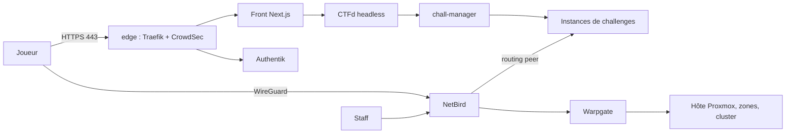

# PenetrateAndDestroy

**PenetrateAndDestroy** (PAD) est une plateforme CTF **jetable** : un seul serveur Proxmox, une seule commande
(`task up`) pour tout reconstruire, une seule (`task destroy`) pour tout effacer. Tout est décrit en code : réseau,
routeur, services, cluster Kubernetes, applications et supervision. Il n'y a aucune configuration manuelle cachée,
sauf quelques actions listées dans [Actions manuelles après déploiement](operations/actions-post-deploiement.md).

Le projet est personnel et public, mais la plateforme est pleinement utilisable : chacun peut la déployer sur son
propre hôte Proxmox, avec ses propres valeurs de site (voir [Valeurs de site](reference/site.md)).

!!! note "Captures d'écran à venir"
    Les captures de l'espace joueur, du scoreboard, du portail manager et des dashboards Grafana seront ajoutées
    après le premier déploiement réel. Les emplacements sont marqués dans les guides.

## Ce que fait la plateforme

- **Un front sur mesure** (Next.js) devant **CTFd en mode headless** : espace joueur, scoreboard en direct,
  gestion d'équipe, notifications, onboarding VPN, et un portail manager.
- **Des challenges instanciés par équipe** : chaque équipe lance, prolonge et arrête sa propre instance, avec un TTL.
  Les instances ne sont joignables que par le **VPN NetBird**, jamais depuis Internet.
- **Une segmentation réseau réelle** : un routeur OPNsense, sept zones VLAN, une matrice de flux « deny all par
  défaut » gérée en code. Voir [Réseau et zones](architecture/reseau.md).
- **Un cluster Kubernetes qui scale avec la charge** : Talos Linux, Cluster API, ArgoCD, KEDA et un autoscaler de
  nœuds. Voir [Scaling](architecture/scaling.md).
- **Un SSO unique** (Authentik) pour le front, NetBird, Warpgate, Grafana et ArgoCD, avec un bastion (Warpgate)
  pour le personnel.
- **Une supervision complète** : métriques, logs, traces, 4 dashboards, 67 alertes, chacune avec un
  [runbook](runbooks/index.md).
- **Des secrets versionnés chiffrés** (SOPS + age) : le dépôt est public sans rien divulguer. Voir
  [Chaîne des secrets](architecture/secrets.md).
- **Un import de challenges simple** : ZIP envoyé depuis le portail manager, ou synchronisation depuis un
  **dépôt Git privé** séparé. Voir le [guide manager](manager/index.md).

## Par où commencer

| Je veux... | Page |
|---|---|
| déployer la plateforme | [Démarrage rapide](demarrage-rapide.md) |
| comprendre comment c'est construit | [Architecture](architecture/index.md) et [décisions](adr/index.md) |
| réagir à une alerte | [Runbooks](runbooks/index.md) |
| jouer | [Guide joueur](player/index.md) |
| publier des challenges et animer un événement | [Guide manager](manager/index.md) |
| chercher une valeur, une tâche, une API | [Référence](reference/contrat.md) |

## Vue d'ensemble

## Organisation du dépôt

Le dépôt est un monorepo. Les dossiers principaux :

| Dossier | Contenu |
|---|---|
| `infra/tofu` | stacks OpenTofu : réseau de l'hôte, routeur, LXC, Authentik, NetBird, Warpgate, règles, DNS |
| `infra/ansible` | rôles qui configurent l'hôte et les services en Docker Compose dans les LXC |
| `bootstrap` | cluster `kind` éphémère, Cluster API, pivot, installation d'ArgoCD |
| `gitops` | tout ce qui tourne dans Kubernetes (plateforme, applications, cluster de prod) |
| `apps` | front, plugins CTFd, `netbird-sync`, scénario `chall-manager` |
| `challenges` | schéma de `challenge.yml` et trois exemples |
| `monitoring` | dashboards, règles d'alerte, configuration Alertmanager |
| `infra/contracts.yaml` | **source unique** des IP, CIDR, noms, ports et groupes |

## Conventions de cette documentation

Tous les exemples utilisent des valeurs fictives : domaine `example.net`, secrets `CHANGEME`. Les plages privées sont
celles du contrat (`10.20.0.0/16`). Aucune valeur de site n'est publiée.
