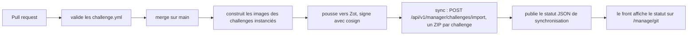

# Mode Git : dépôt privé de challenges

Pour un vrai événement, les challenges (flags, solutions, sources) vivent dans un **dépôt Git privé, séparé** de
PenetrateAndDestroy. Une CI valide, construit, signe puis synchronise vers CTFd. Le dépôt public ne contient que des
exemples.

!!! danger "Pourquoi un dépôt séparé"
    Un dépôt public avec des flags en clair ruine l'événement. Les flags d'un `challenge.yml` sont en clair : le dépôt
    de challenges doit rester **privé** et son accès limité aux auteurs. Ne mettez jamais un vrai challenge dans le
    dépôt de la plateforme.

## Structure recommandée

```text
ctf-challenges-evenement/            (dépôt privé)
  web/
    portail-admin/
      challenge.yml
      app/                           sources, Dockerfile
  crypto/
    xor-warmup/
      challenge.yml
      cipher.bin
  pwn/
    ret2win/
      challenge.yml
      Dockerfile
  .github/workflows/sync.yml         CI (exemple plus bas)
```

Un dossier = un challenge = un `challenge.yml` à sa racine (format : [challenge.yml](challenge-yml.md)). Le nom
(`name`) est la clé d'idempotence : le garder stable.

## Ce que fait la CI



1. **Validation** sur chaque pull request : schéma (`challenges/validate.py` du dépôt de la plateforme, ou copie du
   schéma `challenges/schema/challenge.schema.json`).
2. **Images** : pour chaque challenge avec `instance`, build, scan, push vers `registry.pad.internal`, signature cosign.
3. **Synchronisation** : un ZIP par challenge vers l'endpoint d'import (idempotent). Un challenge supprimé du dépôt n'est
   **pas** supprimé de CTFd automatiquement : le retirer depuis CTFd.
4. **Statut** : un JSON résumant la synchro, lu par le front.

## Accès de la CI à la plateforme

La CI doit joindre **deux services internes** : l'endpoint d'import de CTFd et le registry. Aucun n'est public.

| Besoin | Solution |
|---|---|
| joindre CTFd et Zot | runner **auto-hébergé** dans la zone MGMT, ou runner enrôlé dans NetBird (groupe staff) |
| authentification à CTFd | jeton d'API d'un compte de service dédié (manager ou admin), créé dans l'interface CTFd d'administration brute (`ctfd-admin`), **expirant et révocable** |
| authentification à Zot | compte `pad-ci` du registry (mot de passe dans `secrets/credentials.sops.yaml`) |

Le jeton CTFd et les identifiants du registry sont des **secrets du dépôt privé** (secrets de la CI), jamais dans les
fichiers.

!!! note "Jeton de longue durée"
    Les tokens émis par `sso_bridge` (durée 15 min) servent au front. Pour la CI, un jeton d'API CTFd créé pour un
    compte de service est nécessaire. Le choix du compte et de la durée de vie est à valider lors du premier
    déploiement.

## Exemple de workflow

Valeurs fictives ; à adapter au fournisseur de CI du dépôt privé.

```yaml
name: sync-challenges
on:
  pull_request:
  push: { branches: [main] }

jobs:
  validate:
    runs-on: ubuntu-24.04
    steps:
      - uses: actions/checkout@<sha-épinglé>
      - run: pip install pyyaml==6.0.2 jsonschema==4.23.0
      - run: python3 tools/validate.py          # copie de challenges/validate.py et du schéma

  sync:
    if: github.ref == 'refs/heads/main'
    needs: validate
    runs-on: [self-hosted, pad]                 # runner qui joint CTFd et Zot
    steps:
      - uses: actions/checkout@<sha-épinglé>
      - name: Images
        run: |
          for c in $(grep -l '^instance:' */*/challenge.yml | xargs -n1 dirname); do
            tag=$(yq '.instance.image' "$c/challenge.yml")
            docker build -t "$tag" "$c" && docker push "$tag"
          done
      - name: Import
        env:
          PAD_CTFD_URL: ${{ vars.PAD_CTFD_URL }}
          PAD_CTFD_TOKEN: ${{ secrets.PAD_CTFD_TOKEN }}
        run: |
          for d in */*/; do
            [ -f "$d/challenge.yml" ] && tools/sync.sh "$d"    # copie de challenges/sync.sh
          done
```

!!! warning "Le build des images"
    L'exemple omet volontairement la signature cosign et le scan. Ajoutez-les : la politique Kyverno `verify-images`
    ([Kyverno](../runbooks/kyverno.md)) bloquera à terme les images non signées une fois passée en `Enforce`.

## Statut de synchronisation affiché par le front

La page **Git** du portail lit un JSON publié par la CI à l'adresse `PAD_GIT_SYNC_STATUS_URL` (variable du front). Sans
cette variable, la page indique qu'aucun statut n'est publié. Format :

```json
{
  "commit": "a1b2c3d",
  "branch": "main",
  "syncedAt": "2026-10-16T10:00:00Z",
  "results": [
    {"name": "Portail Admin", "status": "updated"},
    {"name": "XOR Warmup", "status": "unchanged"},
    {"name": "Ret2Win", "status": "failed", "message": "422: instance.ttl: ..."}
  ]
}
```

`status` vaut `created`, `updated`, `unchanged` ou `failed`. Le statut peut être déposé dans un objet Garage lisible ou
un artefact de CI accessible au front. Cette brique est décrite dans le plan comme restant à finaliser (voir
[limites connues](../reference/limites.md)).

## Bonnes pratiques

- Une pull request par challenge ; revue croisée avec **résolution du challenge par un autre auteur** avant le merge.
- Importer en `state: hidden`, tester via le [test d'instance](exploitation-evenement.md#test-dinstance), puis passer en
  `visible` dans une seconde PR.
- Épingler les images par digest pour les challenges instanciés.
- Ne jamais stocker de secret d'infrastructure dans le dépôt de challenges.
- Garder la liste des accès au dépôt aussi courte que l'équipe d'auteurs.
