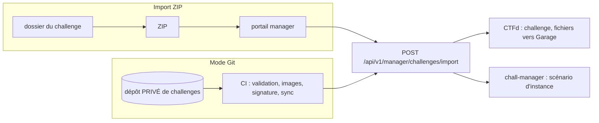

# Guide manager

Le **portail manager** (`/manage` sur le front) permet d'animer un événement sans jamais ouvrir l'interface
d'administration de CTFd. Accès : être membre du groupe Authentik `ctf-managers` (ou `ctf-admins`).

!!! note "Captures à venir"
    Vue d'ensemble du portail, assistant d'import, statistiques d'un challenge, modération, page Git.

## Ce que permet le portail

| Page | Fonction | Détails |
|---|---|---|
| Challenges | liste de tous les challenges (tous états), solves, tentatives, taux de réussite, statistiques par challenge | [Instances, événement, modération](exploitation-evenement.md#statistiques) |
| Import | envoi d'un ZIP contenant un `challenge.yml` | [Import par ZIP](import-zip.md) |
| Git | statut de la synchronisation depuis un dépôt de challenges | [Mode Git](depot-prive.md) |
| Test d'instance | lancer et tester un challenge instancié avant publication | [Test d'instance](exploitation-evenement.md#test-dinstance) |
| Événement | dates de début, de fin, gel du scoreboard, pause | [Événement](exploitation-evenement.md#evenement) |
| Modération | bannir/masquer comptes et équipes, invalider soumissions et awards | [Modération](exploitation-evenement.md#moderation) |

## Deux façons de publier des challenges



| | ZIP | Dépôt Git privé |
|---|---|---|
| Pour | un challenge, un correctif rapide | l'ensemble de l'événement, plusieurs auteurs |
| Historique, revue | non | oui (pull requests) |
| Images de conteneurs | à pousser au préalable | construites, scannées et signées par la CI |
| Idempotence | oui (clé = `name`) | oui, même API |

Les deux voies utilisent **le même endpoint et le même format**.

!!! danger "Les vrais challenges ne vont jamais dans ce dépôt public"
    Le dépôt PenetrateAndDestroy est public et ne contient que trois **exemples**. Les challenges d'un vrai événement
    (flags, solutions) vivent dans un dépôt **privé séparé**, ou passent par l'import ZIP. Voir
    [Mode Git](depot-prive.md).

## Cycle de vie d'un challenge

1. Écrire le `challenge.yml` ([format](challenge-yml.md)) et valider localement.
2. Importer : le challenge est créé **masqué** (`state: hidden`) sauf mention contraire.
3. Le tester : fichiers, flag, et instance via le [test d'instance](exploitation-evenement.md#test-dinstance).
4. Le publier : passer `state: visible` dans le fichier puis réimporter (l'état se pilote par le fichier, pas par le portail).
5. Surveiller : solves, taux de réussite, first blood ; corriger au besoin par réimport (mise à jour en place).

## Valider un challenge hors ligne

Le schéma est la source unique `challenges/schema/challenge.schema.json`, vérifié aussi par CTFd et par le front :

```bash
python3 challenges/validate.py                         # tous les exemples
python3 challenges/validate.py chemin/vers/challenge.yml
```

Pour envoyer en ligne de commande plutôt que par le portail :

```bash
PAD_CTFD_URL=https://ctfd-admin.example.net PAD_CTFD_TOKEN=CHANGEME \
  challenges/sync.sh challenges/crypto-xor-static
```

(`sync.sh` zippe le dossier de façon reproductible et appelle l'endpoint d'import.)
