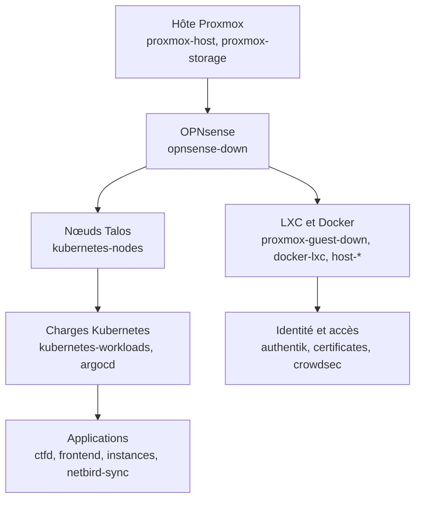

# Incident générique

Pour une panne dont la cause n'est pas encore connue, ou qui ne correspond à aucun runbook d'alerte. Ne pas chercher
à tout comprendre d'abord : **stabiliser, comprendre, corriger, consigner**.

## 1. Cadrer (5 minutes)

- Quel est l'impact ? Joueurs bloqués, challenges inaccessibles, staff privé de bastion, ou supervision aveugle ?
- Un événement est-il en cours ? Si oui, **prévenir les participants** (canal de l'événement, page de statut) avant de
  chercher.
- Depuis quand ? Quel changement récent (commit sur `main`, rotation de secret, mise à jour d'image, `task` lancée) ?
- Quelles alertes sont actives ? Les inhibitions masquent les symptômes : une alerte de cause (`OpnsenseDown`,
  `PveNodeDown`) en cache beaucoup d'autres.

## 2. Remonter la pile, de bas en haut



Une panne en bas explique les pannes en haut. Commencer par la couche la plus basse en défaut.

## 3. Premiers contrôles

```bash
task verify                                   # vue rapide : endpoints, nœuds, ArgoCD, isolement
export KUBECONFIG="$PWD/.state/kubeconfig"
kubectl get nodes
kubectl -n argocd get applications | grep -v 'Synced *Healthy'
kubectl get pods -A | grep -vE 'Running|Completed'
```

Sur l'hôte : `qm list ; pct list ; zpool status -x ; free -h`.

Dans Grafana : dashboards `PAD - Plateforme` puis `PAD - Capacité`. Dans Loki : filtrer par `host` et par niveau
d'erreur sur la période de l'incident.

### Un flux est-il bloqué ?

Les refus d'OPNsense sont journalisés (**Firewall > Log Files > Live View** dans l'interface, la collecte automatique
dans Loki étant un [point ouvert](../reference/limites.md)). Comparer le flux refusé à la [matrice de flux](../architecture/flux.md) :
si le flux est légitime, la règle manque dans `60-opnsense-rules`.

## 4. Stabiliser

Par ordre de préférence :

1. **Réduire l'impact sans toucher à l'infra** : mettre l'événement en pause (portail manager), masquer un challenge
   défaillant, limiter les instances.
2. **Annuler le dernier changement** : `git revert` du commit fautif (ArgoCD réapplique), ou retour à l'ancien secret
   (voir [rotation](rotation-secrets.md)).
3. **Redémarrer le composant** défaillant (`rollout restart`, `docker compose restart`).
4. **Restaurer** depuis une sauvegarde ([procédure](backup-restore.md)).
5. **Reconstruire** la couche ([Rebuild](rebuild.md)) en dernier recours.

## 5. Consigner

Après l'incident, écrire dans un fichier de retour d'expérience (hors dépôt si le contenu est sensible) : chronologie,
cause, détection (quelle alerte, quel délai), correction, et ce qui améliorerait la détection ou la réparation. Si un
runbook était faux ou absent, **le corriger dans le même commit** que le correctif.

## Escalade

Ce dépôt est un projet personnel : l'escalade est vers l'opérateur de l'hôte. Si l'accès à l'hôte Proxmox lui-même est
perdu, c'est le seul blocage non réparable depuis la plateforme.
